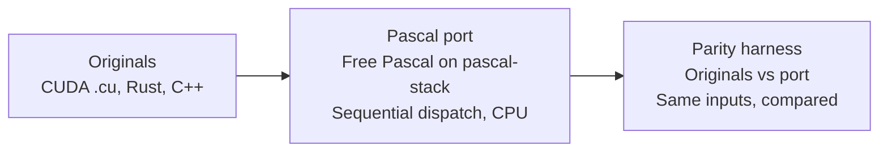

# sovereign-kimi-pascal

[](LICENSE)
[](https://www.freepascal.org/)
[](#how-to-run-it)
[](#what-this-replaces)

**What this is:** the CUDA kernels of `sovereign-kimi`, ported to Free Pascal, running on CPU — no GPU, no nvcc, no CUDA toolkit.

I needed CUDA compute for training work and had no GPU. So I ported the kernels instead of waiting on hardware. The kernels keep their CUDA names, argument lists, and launch geometry — only the execution moved, from GPU threads to sequential Pascal dispatch on CPU. It works: every port is checked against the original or a CPU reference derived from the `.cu` source, and the parity numbers are below.

This is the compute substrate. The repo contains no training loop, optimizer, or backward pass. The runnable program is the K3 nano inference harness: `k3_nano <model.bin> <prompt> <max_tokens> <temp> <top_p>`.

## What this replaces

| Original | Pascal | Notes |
|---|---|---|
| `k3_nano_harness.cu` kernels | `src/SK_K3Kernels.pas`, `src/SK_Launch.pas` | Same names, args, launch geometry |
| `k3_nano_harness.cu` host / main | `src/SK_K3Harness.pas`, `src/k3_nano.pas` | Inference harness, speculative decoding |
| `kimi_butterfly.cu`, `butterfly_factors.cu`, `.sass` | `src/SK_Butterfly.pas` | Includes a SASS interpreter |
| `fused_attention.cu`, `gemm_online_softmax.cu` | `src/SK_Attention.pas` | Fused attention, online softmax GEMM |
| `tensor_pkg`, microcode, `p45.isa`, RTL multiply | `src/SK_TensorPkg.pas` | Tensor package + FP16 |
| `ffi.rs`, `daemon.rs`, `lib.rs` | `src/SK_K3Engine.pas` | Engine / FFI surface |
| `threadpiper.rs`, `state_audit.rs` | `src/SK_ThreadPiper.pas`, `src/SK_StateAudit.pas` | Runtime + audit |
| `kernel_space.cpp`, `forge_compiler.cpp` | `src/SK_KernelSpace.pas`, `src/SK_ForgeCompiler.pas` | Forge: 1490 passes, literal `\n` emit preserved |
| `proof/forge.mlw` (Why3) | `src/SK_ForgeProof.pas` | Proof obligations become `Assert` |
| `*.sv` RTL | `original_hw/` (copied unchanged) | RTL is kept as-is by design; only host driver logic ported |
| half / float helpers | `src/SK_Half.pas`, `src/SK_FloatOps.pas` | RNE rounding, correctly-rounded `fmaf` |



## How it runs without a GPU

`DispatchKernel` runs threads sequentially — no barriers, no shuffles. Kernels with independent threads run per thread; shuffle, `mma`, and `syncthreads` kernels run per warp or block using lane arrays. FP exceptions are masked to match CUDA. Buffers are bounds-checked dynamic arrays, and disjoint input/output is asserted. Where the original has undefined behavior, the port and the reference make the same documented choice: shared memory starts zeroed, `cp.async` data lands at the wait, out-of-bounds `row_max`/`row_denom` reads return NaN, `O_acc` starts at 0, `wmma` warps run serially, and the `attn_out_proj` aliasing is replaced by a snapshot.

## Parity: recorded runs

Recorded runs of `./run_parity.sh`, 2026-10-14, documented in full in `PORT_NOTES.md`:

| Check | Result |
|---|---|
| Rust originals (`threadpiper.rs`, `state_audit.rs`) vs Pascal | 12,800 lines identical |
| Rust originals (`ffi.rs`, `daemon.rs`, stub engine) vs Pascal | 243 lines identical |
| C++ originals (`kernel_space.cpp`, `forge_compiler.cpp`) vs Pascal | 9,452 lines identical |
| CUDA `k3_nano_harness` port vs CPU reference | 8,313 values across 20 tests, 0 mismatches, bit-exact |
| CUDA butterfly, SASS, attention port vs reference | 56,592 values, bit-exact except `gemm_online_softmax` |
| `gemm_online_softmax` | 6 values differ, max rel 4.81e-6, max abs 6.5e-11 — inside the stated tolerance of rel 1e-5. Most of that output is NaN because of UB in the original. |
| Self-checks (Why3 `Assert`s and others) | 2,337 passed, 0 failed |

One line of honesty, stated plainly: **CUDA was never run on a GPU here.** Parity is the port against C++ CPU references derived from the `.cu` source, not against GPU execution. No GPU, no nvcc on the build machine.

## How to run it

Requires Free Pascal 3.2.2 and a checkout of `pascal-stack` (read-only, never modified) — set `PASCAL_STACK` if it is not at `/workspace/pascal-stack`. Also needs `g++`, `cargo`, and `rustc` for the parity harnesses.

```sh
./build.sh        # builds every Pascal unit/program with fpc
./run_parity.sh   # builds the originals + references, runs everything, compares
```

Run the harness directly:

```sh
./build/k3_nano <model.bin> <prompt> <max_tokens> <temp> <top_p> [--speculative draft.bin gamma] [--seed N]
```

`--seed` makes runs reproducible; without it the seed is the current Unix time.

## What the port found in the original

Porting line by line turned up real defects, all documented in `PORT_NOTES.md`:

- `fused_attention`: `V` is unused, `float2` values are written into a `half` buffer, reads go past the tiles, the first K tile is never loaded.
- `gemm_online_softmax`: `row_max` read out of bounds, `O_acc` uninitialized, `P@V` uses only `k=0`.
- Harness: `attn_out_proj` aliasing, `speculative_decode` memcpy reading out of bounds, tied embeddings uploading uninitialized memory, embedding only working for `dim <= 256`, draft FFN outputting 0 (`top_k=0`), `wmma` shared-memory race with lost loads.
- RTL `fp16_mul` is an integer multiply.
- Microcode: 15 of 25 lines have hex ≠ binary (reported, not raised as an error).

## What is not ported

- SystemVerilog: kept as-is by design.
- Mojo: skeleton without compute; only constants ported.
- Python (`create_draft_model.py`): harness only, inconsistent (43-byte unpack from a 40-byte read; 8 `i` with 7 values). Not used as authority.
- Why3: not installed, so the `.mlw` proof was not machine-checked; one `= by omega` lemma syntax looks invalid.

## Layout

```
src/            Free Pascal units (kernels, attention, butterfly, tensor pkg, engine)
tests/          Parity harnesses (Rust, C++, FFI) + kernel/self-check tests
original_hw/    SystemVerilog RTL, copied unchanged
microcode/      ISA (p45.isa) + microcode tables
proof/          forge.mlw (Why3, kept alongside its Pascal port)
refs/           C++ CPU references derived from the .cu source
build.sh        Builds every Pascal unit/program with fpc
run_parity.sh   Builds originals + references, runs everything, compares
PORT_NOTES.md   Full port notes: file mapping, UB choices, defects, parity results
```

## License

AGPL-3.0-only. See `LICENSE`.
